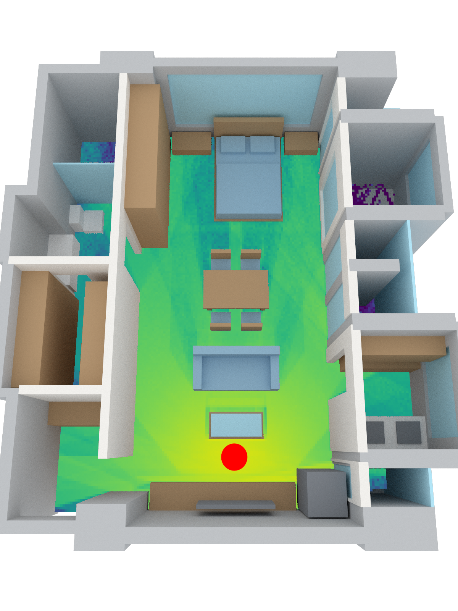
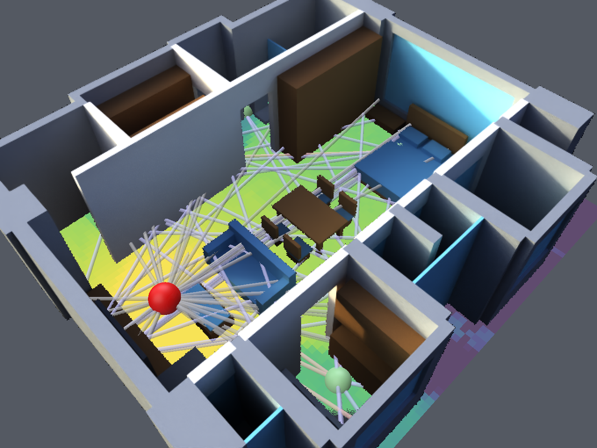
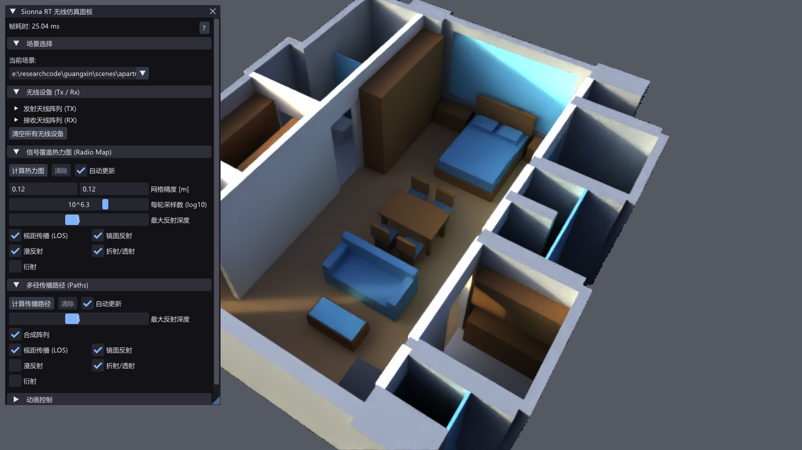
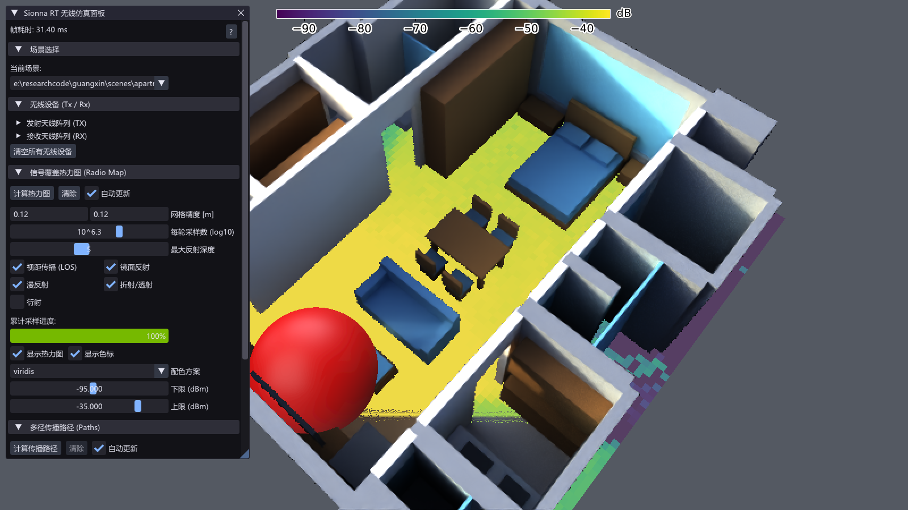
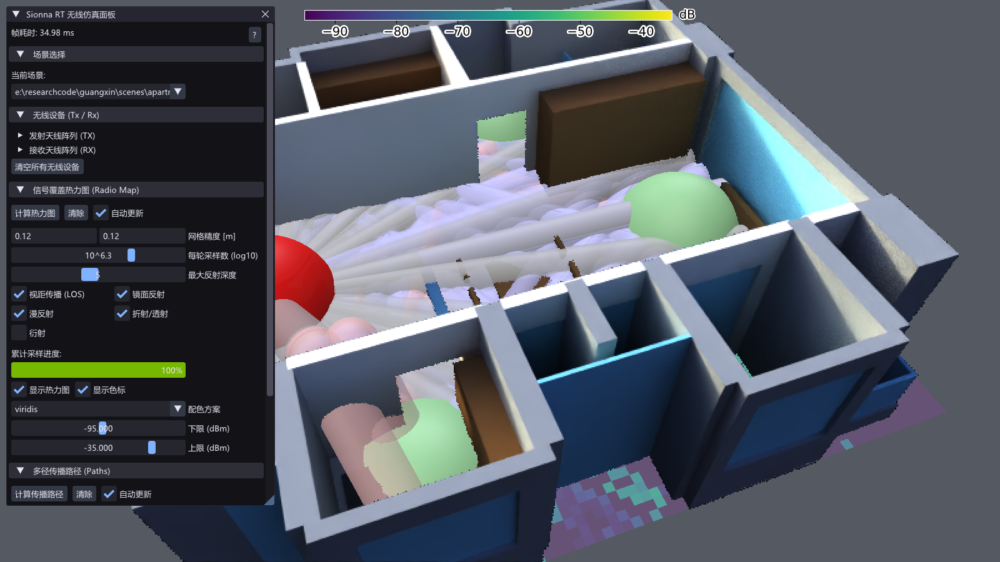
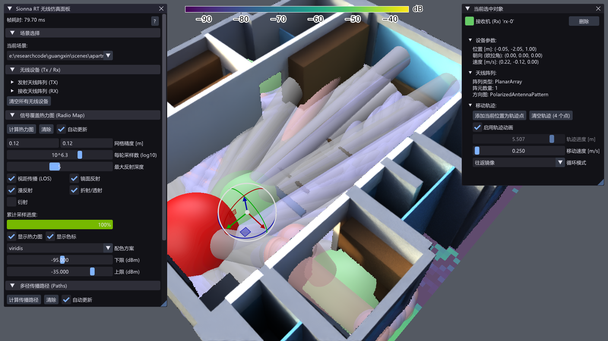

# beacon_rssi_rt

> 一张户型图 + RTX 4070，用 NVIDIA Sionna RT GUI 实时仿真室内 2.4 GHz 蓝牙信号覆盖（附全中文汉化与 Windows 避坑实录）

做室内蓝牙（BLE Beacon）定位、Wi-Fi 感知或无线信道建模时，最让人头疼的往往不是算法本身，而是**“建场景”与“可视化调试”**：

- 真实房间打点采集 RSSI 数据费时费力，且一旦改换家具或墙体材质就得重采；
- 自己用 Python 写射线追踪再套一层 Three.js / Open3D 可视化平台，工程量动辄数周。

其实，NVIDIA 已经正式开源了交互式三维无线仿真工具 **Sionna RT GUI**（基于 Sionna RT 1.2.2 + Mitsuba 3.8.0 + Dr.Jit + Polyscope）。你不需要重新造轮子，只需要把室内三维场景导出为 Mitsuba XML，就能在 GPU 光线追踪视窗里**鼠标拖拽 Tx / Rx 设备、实时计算 2.4 GHz 覆盖热力图（Radio Map）、透视穿墙多径传播路径，甚至支持设备轨迹动画**。

本文将完整记录我们如何在本地 **Windows + NVIDIA GeForce RTX 4070**（Python 3.10.15 `research` 环境）上，从零跑通 **Sionna RT GUI**，按真实户型平面图 1:1 建模室内公寓，攻克 Windows 中文路径与编码崩溃问题并完成**全界面中文汉化**，最终跑通 2.4 GHz BLE 信标室内覆盖与多径仿真的全过程。


---

## 效果海报预览

| 2.4 GHz 室内覆盖热力图 (3:4) | 三维多径信号传播与热力图 (4:3) |
| :---: | :---: |
|  |  |

---

## 一、整体技术路线：无需重造可视化平台

整个室内无线仿真实验的数据流非常清晰：

```text
真实户型图 / Depth Anything 3 (DA3) 实景扫描
        │
        ▼  Open3D / Trimesh 网格化、尺度校准与零平面 Z=0 对齐
  分组 PLY 网格 + Mitsuba XML (绑定 ITU-R P.2040-3 电磁材质)
        │
        ▼  sionna-rt-gui scenes/apartment.xml --config configs/ble_indoor.yaml
  Sionna RT GUI (CUDA / OptiX 硬件光线追踪 + 实时交互)
        │
        ├──► 2.4 GHz 平面信号覆盖热力图 (Planar Radio Map)
        └──► 3D 多径传播路径 (LOS / 镜面反射 / 漫反射 / 穿墙折射)
```

在开始之前，有两个官方文档提到的关键限制需要提前了解：
1. **Radio Map 形态限制**：Sionna RT GUI 当前版本（`0.1.1`，依赖 `sionna-rt==1.2.2`）暂不支持基于任意曲面的 Mesh-based Radio Maps，但原生支持高效收敛的**平面 Radio Maps**（可精确指定测量平面高度 `center`、朝向 `orientation`、范围 `size` 与网格精度 `cell_size`）。
2. **自定义场景规范**：无论是从户型图生成还是由 **Depth Anything 3 (DA3)** 扫描重建的房间，都需要完成**网格修复、米制尺度校准**，以及为不同建筑构件赋予正确的 **ITU 无线电材质**。

---

## 二、Windows + RTX 4070 环境搭建与四大“隐形深坑”

在已有 `depth-anything-3`、`open3d==0.19.0`、`trimesh==4.9.0`、`torch==2.8.0+cu128` 的 `research` Conda 环境（Python 3.10.15）中，安装命令非常简单：

```powershell
conda activate research
pip install sionna-rt-gui
```

安装完成后核心版本如下：
- `sionna-rt-gui==0.1.1`
- `sionna-rt==1.2.2`
- `mitsuba==3.8.0` & `drjit==1.3.1`（自动激活 `cuda_ad_mono_polarized` OptiX 后端）
- `polyscope==2.6.1`

但在 Windows 中文系统下直接运行，我们连续踩中并解决了 **4 个极具代表性的底层坑**——如果你也在 Windows 下折腾 Sionna RT，这一节可以帮你省下大量排查时间：

### 坑 1：Windows 中文用户名导致 NVIDIA OptiX 初始化静默闪退

启用 `cuda_ad_mono_polarized` 后端加载场景时，Python 直接以 Exit Code 1 退出，无任何 Python Traceback。打开 Dr.Jit 的 `Trace` 日志后才发现元凶：

```text
jit_optix_log(): [DISKCACHE] Opened database: "C:\Users\张磊\AppData\Local\NVIDIA\OptixCache\optix7cache.db"
```

OptiX 磁盘缓存遇到包含非 ASCII 字符（如中文用户名）的默认缓存路径时会直接崩溃。

**根治方案**：在环境的 `sitecustomize.py` 中，在导入任何图形库之前强制将 `OPTIX_CACHE_PATH` 指向全英文路径：

```python
import os
_optix_cache_dir = r"E:\program\anaconda\envs\research\optix_cache"
os.makedirs(_optix_cache_dir, exist_ok=True)
os.environ.setdefault("OPTIX_CACHE_PATH", _optix_cache_dir)
```

### 坑 2：Windows GBK (`cp936`) 编码导致 YAML 与 XML 读取报错

Windows 终端默认代码页为 GBK，而 `sionna_rt_gui/config.py` 和 `sionna/rt/scene.py` 中 `open(..., "r")` 均未显式传入 `encoding="utf-8"`，一旦配置文件或场景 XML 中出现中文注释就会抛出 `UnicodeDecodeError: 'gbk' codec can't decode byte ...`。

**根治方案**：
1. 为 Conda 环境永久开启 Python UTF-8 Mode：
   ```powershell
   conda env config vars set PYTHONUTF8=1 PYTHONIOENCODING=utf-8 -p E:\program\anaconda\envs\research
   ```
2. 同步将 `sionna_rt_gui/config.py` 与 `sionna/rt/scene.py` 中的 `open(..., "r")` 显式补全为 `encoding="utf-8"`。

### 坑 3：2.4 GHz 频段下 ITU 材质 `floorboard` 频段越界报错

当场景设为 `2.4e9`（2.4 GHz BLE）时，如果室内木地板使用 `itu-radio-material` 的 `floorboard` 类型，Sionna RT 会抛出：

```text
ValueError: Properties of ITU material 'floorboard' are not defined for this frequency
```

查阅 Sionna RT 源码 `itu.py` 发现，ITU-R P.2040 表中 `floorboard` 仅定义了 **50–100 GHz** 的拟合参数，而 **`plywood`（1–40 GHz）** 与 **`wood`（0.001–100 GHz）** 完整覆盖 2.4 GHz 频段！因此室内木地板统一改用 `plywood` 即可完美通过。

### 坑 4：配置 `PlanarRadioMap` 时 `center / orientation / size` 必须三者齐全

在自定义 YAML（如 `configs/ble_indoor.yaml`）中限定室内热力图范围时，若只写了 `center` 和 `size` 而漏掉 `orientation`，点击“计算热力图”时会触发 `PlanarRadioMap` 校验异常。正确写法必须同时指定三项：

```yaml
radio_map:
  auto_update: true
  center: [0.0, 0.0, 1.0]
  orientation: [0.0, 0.0, 0.0]
  size: [8.4, 9.0]
  cell_size: [0.12, 0.12]
```

---

## 三、全界面中文汉化：让 Polyscope + ImGui 原生显示微软雅黑

原生 `sionna-rt-gui` 为全英文界面。由于 Polyscope 2.6.1 底层封装了 Dear ImGui 1.92（支持动态字体图集），我们可以直接利用 `polyscope.set_prepare_imgui_fonts_callback` 在启动时注入 Windows 微软雅黑字体（`C:\Windows\Fonts\msyh.ttc`）：

```python
def set_chinese_imgui_fonts():
    font_path = r"C:\Windows\Fonts\msyh.ttc"
    if os.path.isfile(font_path):
        ps.set_prepare_imgui_fonts_callback(
            lambda atlas: (atlas.AddFontFromFileTTF(font_path, 17.0),) * 2
        )
```

随后我们对主面板（`gui.py`）、设备选中窗口（`selection.py`）、天线阵列面板（`antenna_array.py`）、轨迹动画控制（`animation.py`）与快捷键帮助弹窗进行了完整汉化，最终呈现效果如下：



---

## 四、1:1 户型图三维建模与 9 类 ITU 电磁材质映射

为了模拟真实居家蓝牙信标的部署环境，我们根据一张典型一室一厅精装户型平面图，通过 Python 脚本 `build_apartment_scene.py` 1:1 构建了层高 `2.8 m`、占地约 `8.4 m × 9.0 m` 的完整室内三维公寓，包含：
- **玄关与更衣室**：入户门洞、玄关鞋柜、双排大衣柜；
- **卫浴间**：洗手台外拓区、马桶、干湿分离玻璃淋浴房、通往主区的门洞；
- **客厅与餐厅**：三人位沙发、玻璃面茶几、整墙电视柜、65 寸壁挂电视、立式双门冰箱、餐桌与四把餐椅；
- **卧室**：北侧大窗、双人床（含床垫被褥双枕头）、左右床头柜、整排大衣柜；
- **厨房与工作阳台**：厨房操作台、不锈钢水槽、双眼燃气灶、滚筒洗衣机、景观阳台玻璃栏杆。

为了保证光线追踪在 2.4 GHz 频段下的物理真实性，我们按结构功能将所有网格分为 9 组，并绑定了对应的 ITU-R P.2040-3 材质与厚度：

| 建筑构件 / 家具组 | 对应 ITU 类型 | 设定厚度 | 电磁传播特征 |
| :--- | :--- | :--- | :--- |
| 四角承重柱、外墙 | `concrete`（混凝土） | `0.24 m` | 2.4 GHz 穿墙衰减极大，形成主要阴影区 |
| 室内轻质隔断墙 | `plasterboard`（石膏板） | `0.12 m` | 透射衰减适中，产生穿墙路径 |
| 主空间木地板 | `plywood`（实木复合） | `0.08 m` | 地面反射面 |
| 厨卫与阳台地砖 | `marble`（石材瓷砖） | `0.08 m` | 高介电常数反射面 |
| 门窗玻璃与淋浴隔断 | `glass`（建筑玻璃） | `0.012 m` | 透射率高，兼具镜面反射 |
| 衣柜、床架、餐桌柜 | `wood`（实木） | `0.04 m` | 室内散射与轻度遮挡 |
| 沙发、床垫、被褥 | `ceiling_board`（多孔介质） | `0.10 m` | 低介电常数弱吸收体 |
| 冰箱、电视、洗衣机、灶台 | `metal`（金属） | `0.02 m` | 极强镜面反射体，完全阻挡直达透射 |
| 洁具与石材台面 | `marble`（陶瓷/石材） | `0.05 m` | 厨卫局部反射 |

---

## 五、2.4 GHz BLE 室内信号仿真实验

启动命令（或在 `run_gui.bat` 中一键启动）：

```powershell
conda activate research
cd e:\researchcode\guangxin
sionna-rt-gui scenes/apartment.xml --config configs/ble_indoor.yaml
```

### 1. 放置 BLE Beacon 与生成全屋平面热力图

在客厅电视墙附近按快捷键 **`K`**（或 **`Ctrl + 鼠标左键`**）放置一个 2.4 GHz 虚拟 BLE 发射机 `tx-0`，随后按 **`M`** 或点击左侧面板**“计算热力图”**。



从距地 `1.0 m` 高度、空间分辨率 `12 cm × 12 cm` 的平面热力图可以直观观察到：
- **客厅与餐厅核心区**处于 `-45 dBm ~ -55 dBm` 的强覆盖区；
- **转角冰箱（金属）与厨房南侧承重墙**后方形成明显的信号阴影区（衰减 15–25 dB）；
- **石膏板隔墙与门洞处**呈现出清晰的衍射与透射梯度。

### 2. 多房间跨墙多径传播路径追踪

在**卧室床头**、**厨房操作台旁**和**卫浴间洗手台前**分别放置三个 BLE 接收端（`rx-0`, `rx-1`, `rx-2`），GUI 借助 RTX 4070 硬件光线追踪（最大深度 `max_depth=5`，开启视距、镜面反射与折射透射）立即绘制出三维多径射线：



可以清楚地看到：
- 客厅到卧室（`rx-0`）以**直线视距路径**与**左右墙面一次/二次反射**为主；
- 客厅到厨房（`rx-1`）与卫浴间（`rx-2`）则依赖**经门洞绕射/反射的绕行路径**以及**穿过石膏板隔墙的折射透射路径**到达接收端，解释了室内 RSSI 剧烈波动的多径干涉机理。

### 3. 设备拖拽与轨迹移动实时仿真

左键点击选中任意设备（如卧室的 `rx-0`），右上角弹出设备参数与动画控制面板，同时三维空间出现可拖拽的坐标轴（Gizmo）：



为 `rx-0` 添加从卧室穿过餐厅走向客厅的轨迹点并点击播放后，接收机以步行速度在室内连续移动，每次位置更新都会驱动后台重算多径射线与信号状态，非常适合用于演示和评估动态 BLE 定位与跟踪算法。

---

## 六、如何接入 Depth Anything 3（DA3）实景扫描房间？

走通上述合成户型后，下一步就是把手机拍摄的真实房间通过 **Depth Anything 3 (DA3)** 重建并直接导入 Sionna RT GUI。为此我们在工程目录下配套编写了一键转换脚本 `da3_to_sionna_xml.py`：

1. **自动网格化与修复**：若 DA3 导出的是点云（`.ply`），脚本自动调用 Open3D 估算一致性法线并执行 Poisson 表面重建与离群三角面裁剪；若已是网格，则执行重复顶点/退化面清洗。
2. **尺度校准与零平面居中**：通过 `--scale` 将无尺度单目重建结果对齐到真实米制单位，并将房间的 XY 中心对齐原点、最低点对齐 `Z = 0`。
3. **一键导出 XML 并启动 GUI**：
   ```powershell
   python da3_to_sionna_xml.py --input your_da3_room.ply --scale 1.0 --material concrete --out-dir scenes
   sionna-rt-gui scenes/room.xml --config configs/ble_indoor.yaml
   ```

---

## 七、小结

借助 **Sionna RT GUI**，我们无需编写一行额外的 3D 渲染引擎代码，就能在消费级 RTX 4070 显卡上拥有一套**带物理级电磁材质、全中文操作界面、支持热力图与动态轨迹仿真**的 2.4 GHz 室内无线信号孪生平台。后续只需配合 DA3 扫描真实房间并微调材质标签，即可低成本生成高保真仿真数据，加速室内 BLE 定位、指纹库构建与无线感知研究。
